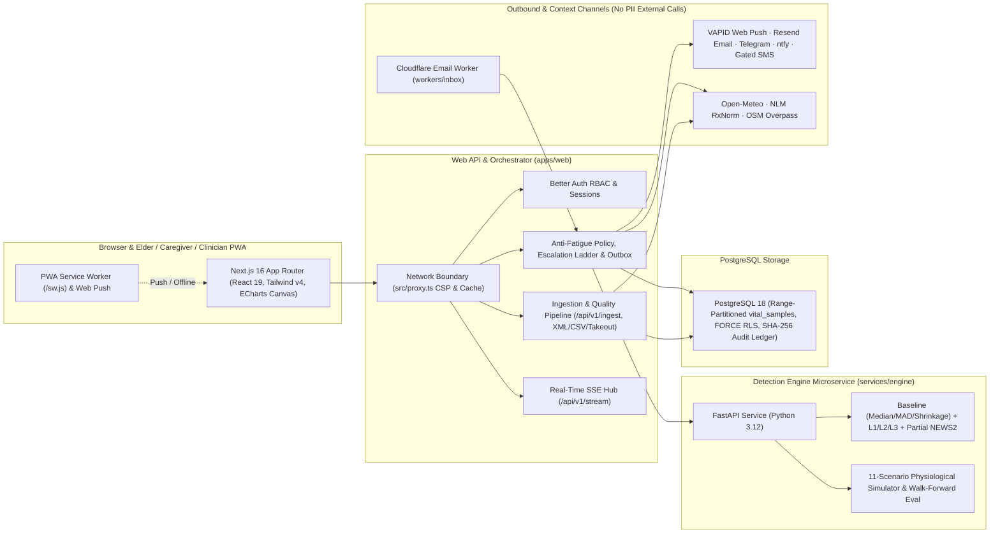
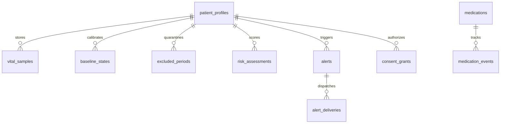
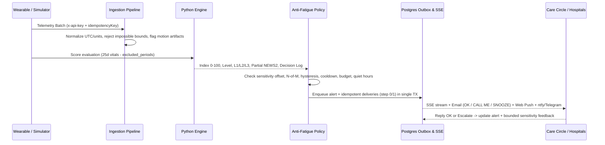

# System Architecture — Sachet · SENTINEL

> **Status:** Verified Implementation · Late November 2026  
> **Scope:** End-to-end architecture, data model, security threat model (STRIDE), RADIO frontend design, and free-tier deployment blueprint.

---

## 1. System & Container Overview (C4 Level 2)

---

## 2. Database Entity & Security Model

PostgreSQL acts as the single source of truth via Drizzle ORM (`apps/web/src/db/schema.ts`) and raw SQL security migrations (`apps/web/src/db/migrations/0001_init.sql`):

- **Time-Series Partitioning:** `vital_samples` is range-partitioned monthly by `recorded_at` alongside pre-aggregated `vital_rollups_hourly` tables (`patient_id, bucket_start, metric_type, context`) preventing full scans in ECharts.
- **Row-Level Security (`FORCE ROW LEVEL SECURITY`):** Non-superuser `sentinel_app` (`NOBYPASSRLS`) executes user-scoped transactions via `withUserDb(userId)` invoking `SECURITY DEFINER` function `sentinel_has_patient_access(patient_id)`. Unlinked users receive `0` rows at the database layer.
- **Field-Level PHI Encryption:** Patient full names, phone numbers, and emergency contacts use `AES-256-GCM` AEAD (`@sentinel/shared`) before persistence.
- **Tamper-Evident Audit Chain:** `audit_logs` locks mutations via `BEFORE UPDATE OR DELETE` PostgreSQL triggers and maintains sequential `SHA-256` links (`prev_hash` -> `entry_hash`).

---

## 3. Alert Escalation & Transactional Outbox Sequence

---

## 4. Detection Engine Architecture (`services/engine`)

1. **Contamination-Quarantined Baseline (`engine/baseline.py`):**
   - Per-person, per-metric weighted median and `1.4826 * MAD` scale floored cleanly against `MIN_SIGMA_FLOOR`.
   - 14-day empirical Bayes shrinkage (`weight = valid_days / (valid_days + 5)`) bridging cold-start days `1..14` with condition priors (`COPD Scale 2`, `heart_failure`, `hypertension`, `diabetes`, `arrhythmia`, `general_frailty`).
   - Excludes `excluded_periods`, tail 48h active windows after sufficient history, and `> 3.5 sigma` transient anomalies.
2. **Three-Layer Deterministic Ensemble (`engine/detectors.py`):**
   - **L1 Safety:** Clinical bounds (NEWS2-aligned + COPD Scale 2) guarded against documented active exercise.
   - **L2 Personal Temporal:** Circadian directional z-score, EWMA drift (`alpha=0.25`), one-sided Page-Hinkley/CUSUM, and `ruptures.Pelt` change-points.
   - **L3 Multivariate Coherence:** `MinCovDet` / `LedoitWolf` Mahalanobis distance, streaming `river.anomaly.HalfSpaceTrees`, and `IsolationForest`. Deep autoencoder remains off behind `ENABLE_AUTOENCODER_L3=false`.

---

## 5. Threat Model Summary (STRIDE) & Privacy Controls

| Threat | Mitigation in SENTINEL |
| :--- | :--- |
| **Spoofing** | Better Auth session cookies + SHA-256 salted `x-api-key` device keys + signed Cloudflare/Telegram webhook secrets |
| **Tampering** | Postgres `BEFORE UPDATE OR DELETE` trigger blocking audit edits + chained `prev_hash -> entry_hash` verification (`/api/v1/audit/verify`) |
| **Repudiation** | Immutable audit entries on consent grant/withdrawal, ingestion batches, engine runs, escalations, and exports |
| **Information Disclosure** | `FORCE ROW LEVEL SECURITY` on `sentinel_app`, `AES-256-GCM` PII blobs, `Cache-Control: no-store` on `/api/*`, rounded `0.01 deg` lat/lon only to Open-Meteo/OSM, zero PII sent to NLM RxNorm |
| **Denial of Service** | Better Auth rate limits, idempotent batch keys, chunked XML streaming (`42` lines buffered statefully), hourly rollups for charts |
| **Elevation of Privilege** | Explicit consent scopes (`vitals_read`, `alerts_receive`, `checkin_view`, `clinician_export`) enforced inside APIs and RLS |

---

## 6. Frontend Architecture (RADIO Framework)

- **Rendering (`R`):** Next.js 16 App Router Server Components paired with isolated client islands (`TanStack Query` caching, Apache ECharts `canvas` mode, single WebGL hero card with `IntersectionObserver` pause & SVG reduced-motion fallback).
- **API & Data (`A` / `D`):** Canonical Zod schemas shared from `packages/shared`, typed route handlers, live `EventSource` SSE updates on `/caregiver` and `/alerts`.
- **Interface & Offline (`I` / `O`):** `DESIGN.md` token CSS variables, >=18px Elder Mode `/today` with >=48px targets, `en`/`kn`/`hi` translations, PWA `manifest.webmanifest` + `/sw.js`, loading/empty/learning/error/offline UI states across all charts.

---

## 7. Local & Free-Tier Deployment Matrix

- **Zero-Docker Windows / Mac Local Parity:** `pnpm dev` runs `apps/web/scripts/boot-local.ts` which automatically initializes an **UTF-8 `embedded-postgres` TCP cluster** (`port 5433`), applies migrations + demo seeds, boots Python `uvicorn` (`port 8000`), and launches Next.js (`port 3000`).
- **Docker Compose (`docker-compose.yml`):** Orchestrates PostgreSQL 18, FastAPI Python Engine, and Next.js Web cleanly.
- **Free-Tier Cloud Target (`DEC-011`):** Vercel Hobby (`apps/web`), Render/Koyeb Free (`services/engine`), Neon Free Postgres, Cloudflare Email Workers Free (`workers/inbox`), Resend Free SMTP, Open-Meteo / OSM / NLM RxNorm public endpoints. See `docs/SETUP-NEEDED.md` for optional secret environment keys.
